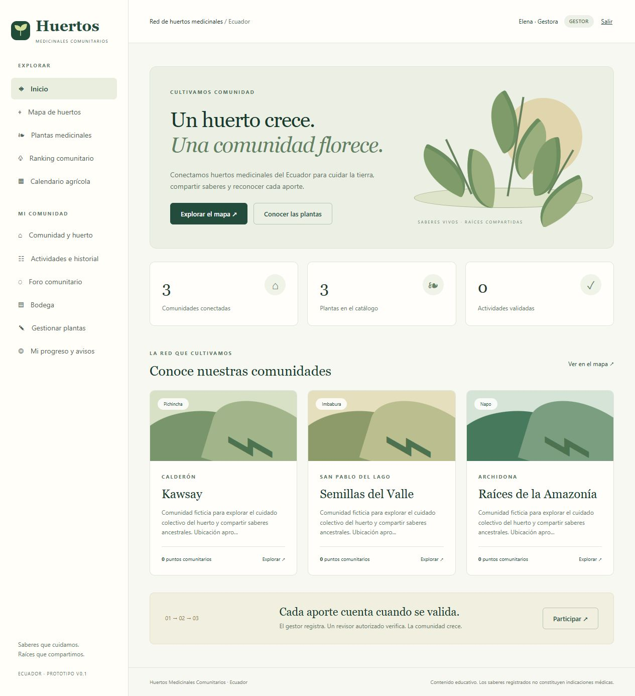

# Huertos Medicinales Comunitarios

Prototipo funcional de una aplicación educativa para huertos del Ecuador. Implementa el recorrido comunidad → huerto → actividad con fotografía → revisión humana → puntos → progreso virtual → ranking. La interfaz y los datos de demostración están en español.

## Inicio rápido

Requisitos: JDK 21 o compatible y conexión a internet para la primera descarga de Maven/dependencias. Incluye Maven Wrapper. En Windows, establecer `JAVA_HOME` al directorio de un JDK válido.

```powershell
.\mvnw.cmd spring-boot:run "-Dspring-boot.run.profiles=demo"
```

También se incluye `iniciar-demo.ps1`, que permite indicar `-JavaHome` y configura una carpeta de sockets para Windows con rutas temporales largas.

En Linux/macOS:

```bash
chmod +x mvnw
./mvnw spring-boot:run -Dspring-boot.run.profiles=demo
```

Abrir [la aplicación local](http://localhost:8080). El perfil **demo** utiliza H2 persistente en `data/`, ejecuta las mismas migraciones y crea tres comunidades ficticias. Se puede cerrar y volver a abrir sin perder datos. **La ejecución normal utiliza PostgreSQL y no crea cuentas de demostración.**

| Usuario demo        | Rol                                               | Contraseña         |
| ------------------- | ------------------------------------------------- | ------------------ |
| `gestor.demo`       | Gestor de Kawsay                                  | `HuertosDemo2026!` |
| `participante.demo` | Participante de Kawsay                            | `HuertosDemo2026!` |
| `revisor.demo`      | Revisor asignado a las tres comunidades ficticias | `HuertosDemo2026!` |

El visitante explora sin iniciar sesión. No habilitar el perfil demo en un servicio expuesto a internet.

## Recorrido de prueba

1. Explorar el mapa, las comunidades, plantas, calendario y ranking sin cuenta.
2. Entrar como gestor. En Actividades, registrar una jornada pasada o del día, seleccionar participantes y adjuntar una fotografía PNG/JPEG real de hasta 5 MB.
3. Comprobar que queda PENDIENTE y que no cambia el ranking ni el huerto virtual.
4. Salir y entrar como revisor. Abrir Revisar evidencias y rechazar indicando un motivo.
5. Volver como gestor. Abrir la actividad y corregir/reenviar. La lista de participantes permanece fija y el historial se conserva.
6. Aprobar el último envío como revisor. Verificar puntos comunitarios, progreso virtual y puntos personales del participante.
7. Explorar el foro como participante, crear un comentario y reportarlo. El gestor de esa comunidad puede resolver el reporte conservando u ocultando el contenido.

Las comunidades empiezan con **cero puntos**, para que todo avance pueda rastrearse a una actividad real del prototipo.

## Tecnologías y estructura

Java 21, Spring Boot 3.5.16, Thymeleaf, Bootstrap 5, JavaScript, Spring Security, JPA/Hibernate, PostgreSQL 17, Flyway, Docker Compose, JUnit y Testcontainers. Bootstrap y Leaflet se incluyen localmente. El mapa usa teselas de OpenStreetMap y requiere internet para el mapa base.

```text
src/main/java/ec/huertos/
  config/       Datos demo y aprovisionamiento del operador
  domain/       Entidades persistentes
  persistence/  Repositorios JPA
  security/     Inicio de sesión, CSRF y autorización HTTP
  service/      Reglas de negocio y transacciones
  storage/      Interfaz de fotografías y adaptador local
  web/          Controladores y manejo de errores
src/main/resources/
  db/migration/ Esquema versionado por Flyway
  templates/    Interfaz renderizada con Thymeleaf
  static/       CSS, JS, ilustraciones y dependencias visuales
src/test/       Aceptación, seguridad y concurrencia
docs/           Análisis de fuentes, trazabilidad y operación
```

Se conserva un monolito por capas. Las entidades usan campos públicos para mantener el prototipo pequeño; las mutaciones HTTP reciben parámetros explícitos y pasan por servicios. No se enlazan entidades completas desde formularios.

## PostgreSQL y Docker

```powershell
Copy-Item .env.example .env
# Editar .env y definir DB_PASSWORD antes de continuar.
docker compose up --build -d
```

Se conserva PostgreSQL en `pgdata` y las fotografías en `photos`. La base no publica un puerto al host. La aplicación publica únicamente `127.0.0.1:8080`. El esquema se aplica automáticamente con Flyway; Hibernate solo lo valida.

La base de PostgreSQL empieza vacía. El operador registra comunidades y gestores mediante el perfil `provision`, y después asigna revisores. Ver [operación y aprovisionamiento](docs/OPERACION.md). No existe un quinto rol ni un formulario público para asignarse permisos.

Sin Docker, establecer `DB_URL`, `DB_USER` y `DB_PASSWORD` en el entorno y ejecutar `java -jar target/huertos-medicinales-0.1.0.jar` contra PostgreSQL.

## Pruebas y empaquetado

```powershell
.\mvnw.cmd verify
java -jar target/huertos-medicinales-0.1.0.jar --spring.profiles.active=demo
```

La suite prueba pantallas, permisos, CSRF, privacidad, límite de integrantes, aprobación, rechazo, reenvío, revisión desactualizada, puntos independientes, imágenes falsas, moderación y aprobaciones simultáneas. `PostgresWorkflowTest` repite las pruebas de aceptación con PostgreSQL real cuando hay Docker; se omite expresamente si no está disponible. GitHub Actions ejecuta `verify` con Java 21 y Docker en Ubuntu y conserva el JAR como artefacto.

## Decisiones de demostración y límites

- La matriz Excel tiene precedencia en los acuerdos revisados. Se aplica RB09: **el progreso cambia solo al aprobar**, aunque RF10 conserve el texto provisional anterior.
- Recompensas **provisionales**: comunidad 10 por actividad; individuo 15 preparación, 20 siembra, 10 cuidado, 25 cosecha. Se capturan en la actividad al crearla. Configurables mediante variables en `application.yml`. No constituyen valores aprobados por el equipo.
- Niveles demo: Oficial 100, Maestro 300; sin cupos. El hito visual usa 5 actividades aprobadas. Insignias, misión y rachas son cálculos derivados de participación aprobada, sin puntos adicionales.
- Calendario: agenda didáctica precargada de noviembre de 2026; las fases aparecen **por validar**. No se han inventado efemérides ni recomendaciones lunares. El operador debe cargar datos y fuentes aprobados antes de usarlo como calendario agrícola real.
- Las fichas botánicas son muestras sin prescripciones, con campos para registrar y verificar las fuentes locales. No hay IA ni reconocimiento de plantas.
- Una comunidad tiene un gestor responsable y un huerto en este prototipo. El acceso a fotos e historial es privado. La ficha pública omite integrantes, credenciales y dirección interna.
- La moderación es humana a partir de reportes y normas visibles. El filtro temático automático, sanciones y apelaciones quedan pendientes. No se permite editar publicaciones o comentarios ya publicados.
- Los reportes exportables RF25 se reservan para otro incremento; RF24 queda pendiente de revisión. El historial de envíos sí está disponible para fines de auditoría.
- RF16 se reconoce mediante cálculo de objetivos; no hay todavía un registro de adjudicación independiente para misiones. Las reglas de rachas, insignias y niveles requieren validación del equipo.
- Listados y agregados están preparados para volúmenes de demostración. Aún se requieren paginación, consultas agregadas y una prueba de carga acordada para verificar el objetivo de 3 segundos.
- Antes de un despliegue público: HTTPS, cookies `secure`, recuperación/cambio de contraseña, límites de intentos de login, revisión institucional de permisos, restauración de respaldos y pruebas de seguridad. Se incluye una base funcional para seguir desarrollando; no una certificación de producción.

Consultar [el análisis y decisiones](docs/ANALISIS.md), [la matriz de cobertura](docs/TRAZABILIDAD.md) y [la arquitectura](docs/ARQUITECTURA.md).

## Evidencia de verificación

[Informe de pruebas, capturas y límites](docs/VERIFICACION.md).


