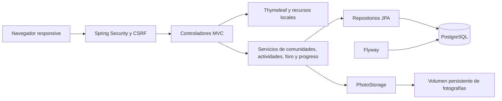
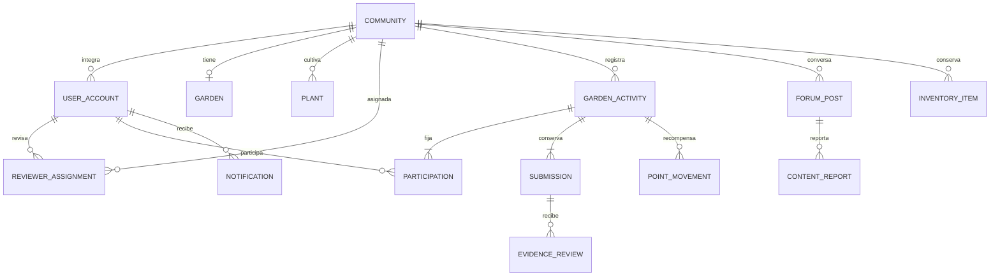

# Arquitectura

Aplicación monolítica modular por responsabilidades, una base PostgreSQL y un adaptador de almacenamiento de fotografías. Los servicios delimitan las transacciones y vuelven a verificar los permisos y la comunidad del usuario.

## Aprobación e idempotencia

`ActivityService.decide` bloquea la actividad mediante `PESSIMISTIC_WRITE`, verifica rol y asignación del revisor, impide autorevisión y exige que la decisión corresponda al último envío. Rechazar requiere observaciones. Solo se revisan actividades PENDIENTES.

En la misma transacción se conserva la decisión, cambia el estado, se crean movimientos comunitarios/personales y se genera un aviso al gestor. Una excepción revierte todos los cambios de base de datos. La representación virtual se calcula de actividades APROBADAS; no hay un contador de avance independiente que pueda desincronizarse.

Cada movimiento tiene una clave de beneficiario `C:{comunidad}` o `U:{integrante}`. La restricción única `(activity_id, beneficiary_key)` impide duplicaciones incluso si otro código intenta repetir una recompensa. Los puntos comunitarios filtran los movimientos sin cuenta; los individuales filtran por cuenta. La recompensa capturada en la actividad permanece fija aunque cambie la configuración posterior.

El reenvío bloquea la misma actividad, añade una nueva versión de evidencia y vuelve a PENDIENTE. Nunca reemplaza la fotografía o revisión anterior ni modifica participantes. No se admite editar actividades aprobadas. Una revisión sobre una versión antigua se rechaza para impedir aprobar una fotografía distinta a la consultada.

## Permisos

| Rol                  | Alcance                                                                                              |
| -------------------- | ---------------------------------------------------------------------------------------------------- |
| Visitante sin cuenta | Mapa, comunidades públicas, plantas, calendario y ranking comunitario                                |
| Gestor               | Datos, huerto, integrantes, plantas, actividades, bodega y reportes de su comunidad                  |
| Participante         | Lectura privada de su comunidad, progreso personal, publicaciones/comentarios y reportes             |
| Revisor              | Evidencias e historial únicamente de comunidades asignadas; aprueba/rechaza, no administra el huerto |

Un solo rol por cuenta; no hay ADMIN genérico. La cuenta inactiva no puede autenticarse ni ejecutar operaciones mediante una sesión anterior. El control de ámbito existe también en servicios y descarga de evidencias, además de restricciones HTTP.

## Extensión recomendada

Mantener los mismos límites transaccionales al separar paquetes funcionales más finos. Añadir DTOs validados y paginación, repositorios con agregados SQL para rankings, registro explícito de adjudicación de misiones, gestión institucional de cuentas y asignaciones, y un adaptador de almacenamiento de objetos con enlaces privados. No se requiere convertir el prototipo en microservicios.
